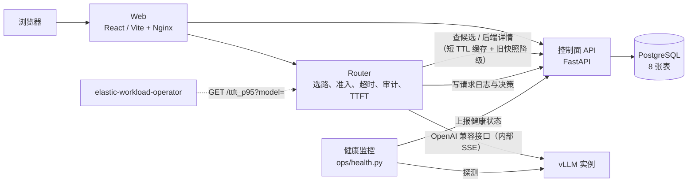
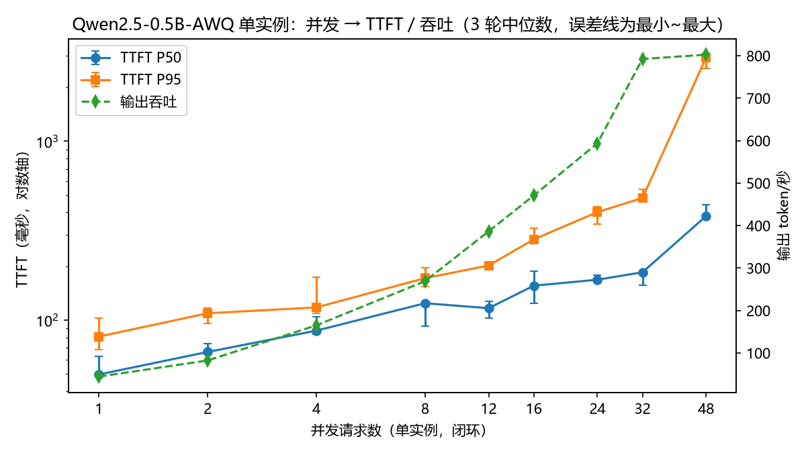
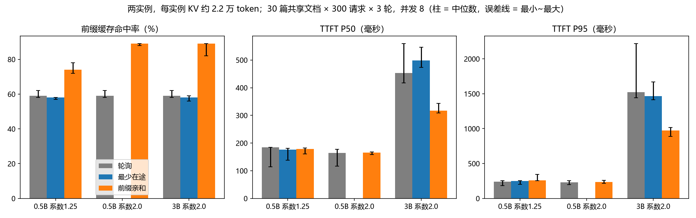

# inference-platform

一个单机 LLM 推理服务平台：在 vLLM 前面加一层 Router，负责选后端、并发准入、超时预算和请求审计，并用实验比较不同路由策略对 KV 前缀缓存命中率和首 token 时延（TTFT）的影响。

> **范围先说清楚**：这是个人项目，用 Docker Compose 跑在一台机器上（一张 RTX 4070 Laptop 8GB），不是生产系统。模型执行直接复用 vLLM，本项目不修改推理引擎。并发准入和控制面缓存都只在**单个 Router 进程**内有效。

## 架构



| 组件 | 目录 | 职责 |
|---|---|---|
| Web | `web/` | 控制台：模型、后端、API Key、请求记录、路由策略 |
| 控制面 API | `services/api/` | 模型、后端、Key 的管理；候选评分；请求审计 |
| Router | `services/router/` | 选后端、单进程并发准入、超时预算、审计写回、TTFT 统计、Prometheus 指标 |
| PostgreSQL | `db/` | 8 张表的初始化迁移与种子数据 |
| 健康监控 | `ops/health.py` | 定期探测后端，连续 3 次失败标记不健康、连续 2 次成功恢复 |
| 发布 | `ops/release_state.py`、`scripts/release.py` | 单机发布互斥、发布记录、失败回退与中断恢复 |
| vLLM | 外部 | 实际执行生成 |

Router 对外接口是自定义的 `POST /v1/route`，不是 OpenAI 兼容接口；内部用 SSE 采集 TTFT，但目前把内容攒齐后一次性返回给客户端，没有做流式透传。

## 核心设计

### 1. 并发准入与 429

- 每个后端有在途上限（`BACKEND_MAX_INFLIGHT`，可按后端单独配置）。
- 选后端和占位在同一把锁内完成，避免两个请求同时看到「还有空位」；无论成功、失败还是取消，都在 `finally` 里释放。
- 所有候选都满时返回 **429**（告诉客户端稍后重试）；没有可用后端时返回 503。
- 准入上限怎么定，见下面的容量实验。

### 2. 超时预算

Compose 默认配置：总请求 30 秒，其中给审计保留 2 秒，执行最多 28 秒；每次查控制面最多 3 秒，调上游最多 25 秒。这些是嵌套的绝对上限，不是依次相加的额度。目的是慢上游不能把审计写回的时间也耗光。

### 3. 审计提交时序

修过一个真实的竞态：请求成功返回后，客户端立即按 ID 查审计记录偶尔得到 404，稍后再查又正常。原因是响应先发出、事务后提交，另一个连接还看不到未提交的数据。修复方式是把「提交成功」放在「返回响应」之前，并用测试（`test_transaction_response_order.py`）观察响应发出的时机。审计写回用 `asyncio.shield` 保护，客户端断开不会打断写入。

### 4. 控制面缓存与降级，以及鉴权陷阱

原来 Router 每个请求要同步调两次控制面（查候选、查后端详情），控制面一慢推理就慢，控制面一挂推理全挂。现在（`services/router/src/control_cache.py`）：

- **短 TTL 缓存**：默认 2 秒（`CONTROL_CACHE_SECONDS`，0 表示关闭）。
- **single-flight**：同一个 key 同时未命中时只有一个请求真正去查，其他请求等它的结果。领头请求被取消时，其他请求会自己重新查，不跟着失败。
- **旧快照降级**：控制面超时、连不上或返回 5xx 时，用最近一次结果继续服务，最多 30 秒（`CONTROL_STALE_SECONDS`）。审计里记 `fallback_reason=control_plane_stale_snapshot`。
- **LRU 上限** 1024 条。
- Prometheus 指标 `router_control_lookups_total{kind, source}` 可以看命中率和降级次数。

**鉴权陷阱**：控制面会校验调用方的 API Key。如果缓存只按（模型、策略）做 key，A 的合法请求填进缓存后，B 拿无效 Key 也能命中缓存，鉴权就被绕过了。所以缓存 key =（sha256(API Key)、模型、策略）。控制面返回 401、403、404 这类**权威拒绝**时，清掉这个 Key 的全部缓存，而且永远不走旧快照；只有「控制面不可用」才降级。（第一版只在 401 时清缓存，审查时发现 403 后控制面宕机会被旧快照重新放行，已修复并按三种状态码补了测试。）

已知取舍：吊销 Key 后最多 2 秒内仍可能被缓存放行，控制面宕机期间最多 30 秒内仍可能被旧快照放行；后端健康状态的变化最多晚 2 秒生效；Router 重启后缓存为空，此时控制面又刚好不可用就只能返回 503。

### 5. KV 前缀亲和路由（`prefix_affinity`）

`services/router/src/affinity.py`：

- **亲和 key**：提示词前 1024 个字符的 sha256（`AFFINITY_PREFIX_CHARS`）。
- **选后端**：rendezvous 哈希（HRW），对每个后端算 hash(key|backend_id) 取最大。后端增减时，只有落在被删后端上的 key 会迁移。
- **有界负载**：上限 = ceil(系数 × (总在途 + 1) / 后端数)，系数默认 1.25（`AFFINITY_LOAD_FACTOR`）。首选后端超过上限就按 HRW 顺序顺延。
- 审计里记录 `selection=rendezvous_bounded_load` 和 `affinity={preferred_id, rank, load_bound}`，rank > 0 表示因负载被顺延。

这是按提示词前缀**猜测**亲和，不是读取引擎上报的真实 KV 状态。

Router 目前支持的策略：`weighted_random`、`least_latency`、`least_inflight`、`prefix_affinity`。

### 6. 发布与恢复

`scripts/release.py <新 tag> --build` 发布，`--recover-only` 恢复中断的发布。有单机互斥锁、持久化发布记录和事务标识；新版本不健康时回退到上一个镜像。回退只恢复应用镜像，**不恢复数据库、配置、Key 或模型**；第一次发布没有已知前版，中断后需要人工处理。

## 服务发现

`ops/discovery.py` 可从 Kubernetes `EndpointSlice` 自动同步推理后端，默认每 5 秒轮询一次：

- `ready=true` 的 endpoint 登记或更新到控制面；`terminating=true` 或不再 ready 的 endpoint 先进入排空，不再接新请求。
- endpoint 消失后保留一个 grace period，超时才标记为 `disabled`，避免滚动更新期间短暂抖动直接删除后端记录。
- 同步以 endpoint 地址和目标端口生成稳定身份，重复轮询是幂等的；它只维护后端登记状态，不部署模型，也不替代 Kubernetes 控制器。
- Router 的控制面缓存默认 2 秒，因此登记或禁用后的请求侧生效还可能再延迟最多约 2 秒。

Kind 单节点验证使用 busybox 推理占位负载，且没有 readiness probe。实测初始登记 4.5 秒、扩容登记 6.1 秒、缩容候选剔除 30.5 秒、完整下线 46.8 秒、Pod 重建登记 2.1 秒。原始结果见 `artifacts/discovery-validation.json`。这些数字验证轮询、排空和重建路径，不代表生产集群 SLA；当前实现也是轮询器，不是基于 watch 的生产级控制器。

## 实验结果

原始数据、汇总和图在 `docs/experiments/kv-affinity-20261019/`，实验脚本是 `scripts/kv_affinity_experiment.py` 和 `scripts/plot_kv_experiments.py`。

**实验条件**：

- 硬件：RTX 4070 Laptop 8GB，WSL2。
- 引擎：vLLM 0.26.0（torch 2.11），两个容器实例，模型 Qwen2.5-0.5B-AWQ；另做了一组 3B 对比。
- **KV 容量被人为限制**：每个实例 `--kv-cache-memory-bytes 268435456`（256MiB，约 2.18 万 token）。默认每个实例有约 21.5 万 token 的 KV，任何负载都放得下，策略之间看不出差别。限制容量是为了模拟「KV 是稀缺资源」的情况，结论不能直接推广到默认配置。
- 每个配置重复 **3 轮取中位数**，误差线为最小到最大。（单轮结果噪声很大，第一次单轮压测时并发 16 出现吞吐骤降，下一档又恢复。）

### 准入上限：并发 → TTFT



单实例 Qwen2.5-0.5B-AWQ，每档 128 个请求，3 轮中位数：

| 并发 | TTFT P50 | TTFT P95 | 输出 tok/s |
|---|---|---|---|
| 1 | 50ms | 81ms | 44 |
| 8 | 124ms | 172ms | 269 |
| 16 | 156ms | 283ms | 471 |
| 32 | 185ms | 482ms | 792 |
| 48 | 381ms | 2936ms | 802 |

结论：`max-num-seqs=32` 之后只增加排队，吞吐不再上升。准入上限要和 SLO 一起定：要求 TTFT P95 ≤ 300ms 时取 16，只看吞吐时取 32。这是 0.5B 模型的数字，其他模型要按同样方法单独测；Compose 里的默认 `BACKEND_MAX_INFLIGHT=4` 没有据此修改。

### 前缀亲和对比



两个实例，30 篇共享文档 × 300 个请求，并发 8，3 轮中位数：

| 组 | 策略 | 前缀缓存命中率 | TTFT P50 | TTFT P95 | 总用时 |
|---|---|---|---|---|---|
| 0.5B，系数 1.25 | 轮询 / 最少在途 / 亲和 | 59% / 58% / 74% | 相当 | 亲和略差 | 相当 |
| 0.5B，系数 2.0 | 轮询 / 亲和 | 59% / 89% | 相当 | 相当 | 相当 |
| 3B，系数 2.0 | 轮询 / 最少在途 / 亲和 | 59% / 58% / **89%** | 453 / 498 / **317ms** | 1521 / 1464 / **973ms** | 133 / 135 / **91s** |

怎么理解：

1. **命中率提升不一定换来时延下降**，取决于 prefill 在 TTFT 里占多少。0.5B 的 prefill 很便宜，省下来也看不出；3B 的 prefill 贵，亲和让 TTFT P50 降约 30%、P95 降约 35%，总用时少约 32%。
2. **负载系数要和后端数一起看**。2 个后端、系数 2.0 时，上限 = 总在途 + 1，首选后端永远不会超限，等于没有负载保护（有一轮请求分布到了 218 对 82）。系数 1.25 时顺延太多，亲和被稀释。后端更多时效果会不同，需要另测。

**三点证据边界**：

1. **策略顺序固定**：每轮都是轮询 → 最少在途 → 亲和，顺序与 GPU 温度等因素可能混杂；实验没有随机化顺序，无法确定偏差方向。下次应轮换顺序并记录 GPU 频率。
2. **笔记本 GPU 温度影响**：每组第一轮明显更快（约 26 秒对 40 秒），疑似升温降频。
3. **没有走 Router 的 HTTP 全链路**：实验直接调用 Router 的准入和选择代码，再直连两个 vLLM。验证的是选择算法，不是整个服务的端到端性能。

## 测试

2026-10-19 分模块直接运行，全部通过：

| 模块 | 数量 | 命令 |
|---|---|---|
| Router | 70 | `cd services/router && python -m pytest -q` |
| 控制面 API | 87 | `cd services/api && python -m pytest -q`（需要 `TEST_DATABASE_DSN` 指向**可销毁**的隔离测试库，测试会重建 public schema） |
| 前端 | 20 | `cd web && npm test` |
| 根目录运维与服务发现 | 17（运维 7 + 服务发现 10） | 仓库根目录 `python -m unittest discover -s tests` |

合计 194 项。这些是单元和模块测试，不是浏览器冒烟或端到端压测。`scripts/check.py` 是串行跑全部检查的总入口；本轮同时验证了 Web 生产构建成功。

## 快速开始（Docker Compose）

```bash
cp .env.example .env          # 示例值仅用于本机开发，自己改掉密码和 pepper
docker compose up -d postgres
docker compose --profile tools run --rm init   # 初始化数据库，生成管理员 Key 到 .state/admin-key（权限 600，不入 Git）
docker compose up -d --build
```

端口（都只绑定 127.0.0.1）：Web 18080，API 18000，Router 18001，PostgreSQL 55433。

注册一个已经在运行的 vLLM（地址要从 Router 容器内可达，容器里的 `127.0.0.1` 指容器自己）：

```bash
python scripts/register_engine.py --url http://<vllm 地址>:<端口> --model <模型名>
```

`scripts/release.py` 会真实替换正在运行的服务，使用前先看「发布与恢复」一节。

## 目录结构

```text
services/api/        控制面 API（FastAPI、SQLAlchemy、评分、审计）
services/router/     Router（准入、选路、亲和、控制面缓存、TTFT、Prometheus）
web/                 React / TypeScript 控制台
db/                  迁移与种子数据
ops/                 健康监控、发布状态
scripts/             初始化、检查、冒烟、发布、实验与验证脚本
packaging/           本机镜像与 vLLM 运行配置
docs/experiments/    实验原始数据与图
tests/               运维模块测试
compose.yaml         单机部署
```

## 与 elastic-workload-operator 的关系

[elastic-workload-operator](https://github.com/fei232401/elastic-workload-operator) 是我的另一个项目，在 Kubernetes 上协调训练和推理副本。本项目的 Router 是它的指标源：

- `GET /ttft_p95?model=xxx` 返回指定模型最近 30 秒窗口（`TTFT_WINDOW_SECONDS`）的 TTFT P95、样本数、最近样本时间，并回显 `model`。不传 `model` 时使用 `TTFT_MODEL`。
- Operator 用样本数和样本时间判断指标是否可信，用 `model` 回显防止拿错模型的数据。

TTFT 窗口按模型隔离，但只是单个 Router 进程内的统计；Router 多副本时需要另做聚合。

## 来源

本仓库由原来的四个仓库（ai-infra-platform-api、ai-infra-platform-db、ai-infra-platform-router、ai-infra-platform-web）合并而来，原仓库已归档只读。原仓库路径和提交记录在 `docs/source-provenance.json`。
